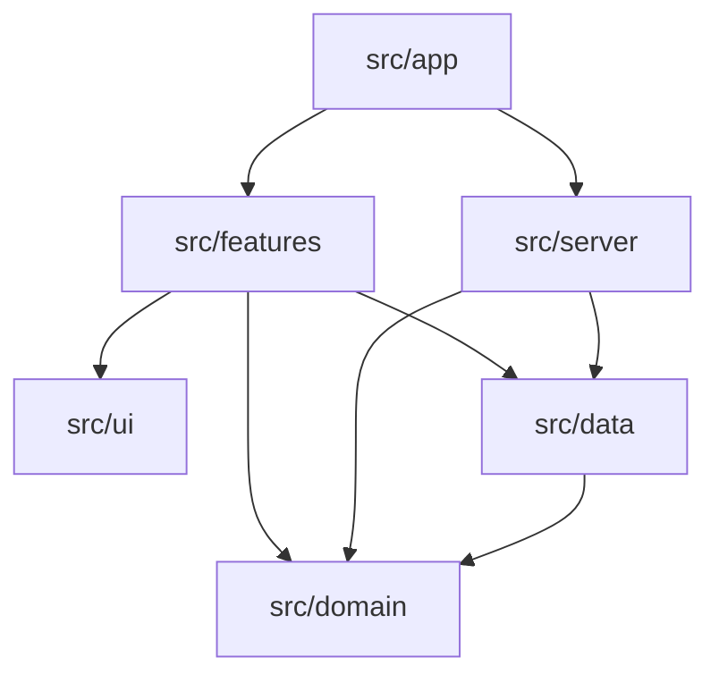
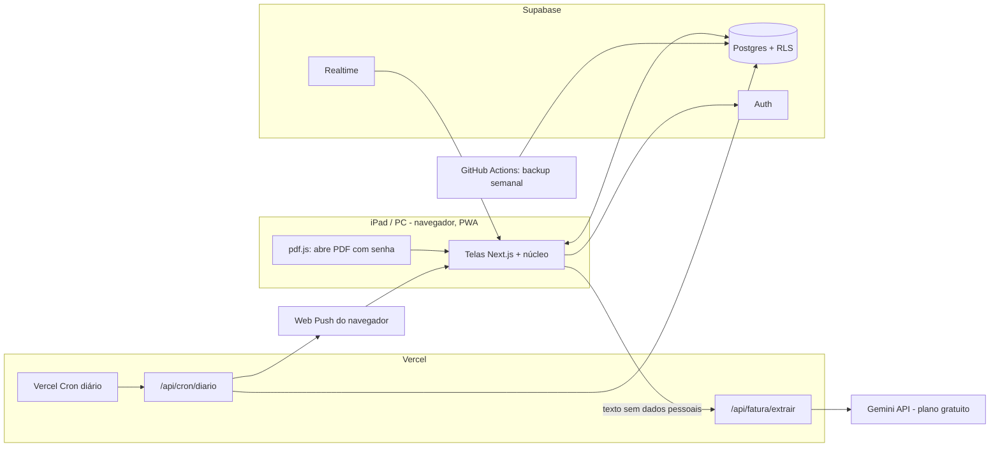
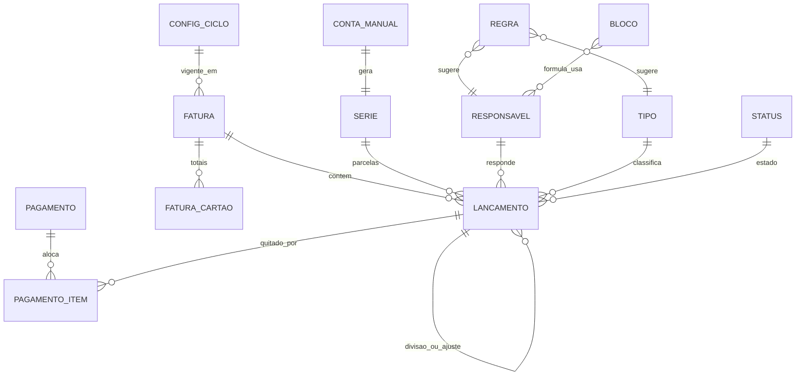

# Architecture Spine — Conta Comigo

## Design Paradigm

**Functional core, imperative shell.** Todo cálculo e toda regra de negócio vivem num núcleo de TypeScript puro (`src/domain`), sem acesso a rede, banco, relógio ou DOM ("hoje" e o Mês aberto entram como parâmetro). A casca (Next.js no navegador e no servidor, Supabase) busca dados, chama o núcleo e grava o resultado.

| Camada | Pasta | Pode depender de |
| --- | --- | --- |
| Núcleo de domínio | `src/domain` | nada além de TypeScript e `zod` |
| Acesso a dados | `src/data` | `src/domain`, `@supabase/*` |
| Funcionalidades (telas e estado de tela) | `src/features/<area>` | `src/domain`, `src/data`, `src/ui` |
| Componentes visuais | `src/ui` | nada de domínio nem de dados |
| Rotas do Next.js | `src/app` | `src/features`, `src/server` |
| Código só de servidor | `src/server` | `src/domain`, `src/data` |



## Invariants & Rules

### AD-1 — Regras de negócio só no núcleo de domínio

- **Binds:** FR-6, FR-8 a FR-12, FR-15, FR-17, FR-19 a FR-33, FR-44 a FR-49, FR-53, FR-54, FR-55
- **Prevents:** duas telas (ex.: Painel e Recebimentos, Bloco e Mensagem) calcularem o mesmo valor de formas diferentes.
- **Rule:** Conferência, classificação (Regras, herança de parcelas, sugestões), Divisão, geração e casamento de previstos, Contas manuais, Ajuste, avaliação de Fórmula, Mensagem de cobrança, alocação de Pagamento, estado derivado (pago, restante, Pago parcialmente, Atrasado, Verificar, previsto), Ciclo/Mês, Previsão e lembretes são funções puras exportadas por `src/domain`. Telas, rotas e SQL não reimplementam nenhuma dessas regras: chamam o núcleo. As RPCs em SQL só gravam o que o núcleo calculou e garantem a transação e as restrições. O núcleo não importa nada de `src/data`, `src/ui`, `src/app`, Next.js, Supabase nem APIs só de Node ou só de navegador.

### AD-2 — Dinheiro em centavos inteiros, um só arredondamento

- **Binds:** todo valor em R$ (Lançamento, Divisão, Bloco, Pagamento, Previsão)
- **Prevents:** arredondamento acumulado e diferenças de 1 centavo entre telas.
- **Rule:** valores são inteiros em centavos (`integer` no Postgres, `number` inteiro no TS, nome terminado em `_centavos` / `Centavos`). Não existe `float` nem `numeric` para dinheiro. Existe uma única função de arredondamento no núcleo: meio para longe do zero (`0,5 → 1`, `-0,5 → -1`). **Divisão:** cada parte, menos a última, é `arredondar(valor × fração)`, e a última recebe `valor − soma das outras` (Monjaro R$ 466,00 em 2/3 + 1/3 = R$ 310,67 + R$ 155,33). **Fórmula:** calcula em racional exato e arredonda só o resultado final. A exibição usa só o formatador do núcleo, montado à mão (`R$ 1.140,74`, `- R$ 0,08`, com espaço inseparável), nunca o `Intl` direto.

### AD-3 — Supabase é a única fonte da verdade; sem internet, só leitura [ADOPTED]

- **Binds:** FR-34, FR-35, FR-46, todas as gravações
- **Prevents:** filas locais divergentes, gravações duplicadas e conflitos de sincronização.
- **Rule:** toda gravação vai direto ao Supabase, e o app considera a gravação feita só quando o banco confirma. Um único detector de conexão (`src/data/conexao.ts`) informa todas as telas. Sem conexão, o app mostra só os dados já carregados e bloqueia toda ação que grava, com o aviso do UX. Não existe fila de gravação no aparelho. O service worker (um só, em `src/app`) guarda só o "casco" do app e nunca responde gravações. Entre aparelhos, vale a última gravação **por coluna**: a gravação manda só as colunas alteradas, e `updated_at` é definido pelo banco.

### AD-4 — Atualização em tempo real por um único gerenciador

- **Binds:** FR-46, NFR "Atualização em tempo real"
- **Prevents:** telas desatualizadas, cada tela com seu cache e eventos aplicados fora de ordem.
- **Rule:** existe um único gerenciador em `src/data/realtime.ts`, que guarda as linhas do usuário em memória e é a única fonte de estado de dados das telas (as telas leem por hooks dele e não guardam cópias). Ele registra os ouvintes antes do `subscribe()` e, ao (re)conectar, relê o Mês aberto. Toda RPC devolve as linhas afetadas, que o gerenciador aplica em lote. Um evento só substitui uma linha se o `updated_at` for mais novo. As tabelas assinadas têm `replica identity full`. Uma tela pode mostrar uma gravação otimista, mas a desfaz se o banco recusar. **Totais calculados** (Blocos, Saldos, Previsão) nunca são gravados. **Totais lidos da Fatura** (total geral e por cartão) são guardados.

### AD-5 — Usuário único com isolamento por dono [ADOPTED]

- **Binds:** FR-34, NFR Privacidade
- **Prevents:** dado acessível sem login e tabelas esquecidas sem proteção.
- **Rule:** login pelo Supabase Auth (e-mail e senha, com "Esqueci a senha" pelo e-mail do Supabase), com cadastro público desligado. Toda tabela de negócio tem `owner_id uuid not null default auth.uid()` e RLS ligado, com políticas `owner_id = auth.uid()` para ler e gravar. As chaves usadas são as novas: `sb_publishable_…` no navegador e `sb_secret_…` só no servidor. A sessão é renovada no `src/proxy.ts` do Next 16 com `getClaims()`.

### AD-6 — Identidade do Lançamento: Nome manda, Apelido só aparece

- **Binds:** FR-5, FR-8 a FR-12, FR-45, FR-47, FR-52
- **Prevents:** Regras e previstos casarem pelo texto errado, ou um Apelido quebrar o reconhecimento.
- **Rule:** `nome` guarda o texto exato da Fatura e nunca é alterado. Duas chaves, só do núcleo:
  - `nome_normalizado = normalizarNome(nome)` (maiúsculas, sem acento, espaços colapsados) é a chave exata de previstos, Ajustes e "mesmo Nome" (Apelido em massa).
  - `chaveDeRegra(nome)` (normalização + sem prefixo de adquirente, ex.: `MP*`, `PG*`, `IFD*`) é a única chave da tabela `regras`, guardada com `versao_normalizacao`.

  `apelido` é só exibição. `lancado_por` é um enum fechado (`fatura`, `sistema`, `manual`, `historico`), e quem cria uma Regra é sempre `regrasRepo.aprender()`, de qualquer tela que classifique. A Divisão de uma Regra é guardada em frações.

### AD-7 — Importação da Fatura: senha no aparelho, extração no Gemini, gravação atômica

- **Binds:** FR-3 a FR-7, FR-11, FR-47, FR-51, NFR "< 1 min" e Privacidade
- **Prevents:** a senha sair do aparelho, o PDF ser guardado, uma importação pela metade e dados pessoais desnecessários indo ao Gemini.
- **Rule:**
  1. O navegador abre o PDF com a senha usando o build **legacy** do `pdfjs-dist` (carregado só no cliente) e extrai o texto. A senha e o arquivo nunca saem do aparelho.
  2. Antes de enviar, o núcleo remove do texto CPF, endereço e número de cartão (fica só o final de 4 dígitos).
  3. O texto vai para a rota autenticada `POST /api/fatura/extrair` (`runtime = 'nodejs'`, `maxDuration = 60`), que faz **uma** chamada ao Gemini (modelo em `GEMINI_MODEL`) com `responseJsonSchema` gerado por `z.toJSONSchema` do schema único do núcleo. A extração inclui `tipo_sugerido` (escolhido da lista de Tipos enviada) e `duvida`, que respondem ao FR-11 sem chamada extra. A rota não grava nada e não registra o texto em log.
  4. A resposta é validada pelo mesmo schema. O núcleo faz a Conferência (total geral e por cartão), reconhece Ajustes, casa os previstos e classifica.
  5. A gravação é uma única RPC em transação (`importar_fatura`). Ela recebe também o `updated_at` mais recente lido, e recusa se o Mês mudou desde o cálculo (o app recalcula e tenta de novo). Ou grava tudo, ou nada.
  6. **Reimportação (FR-51):** as linhas novas são casadas com as da Fatura anterior pela chave da Série/linha (AD-8). As casadas mantêm o `id`, a classificação e os Pagamentos. As linhas antigas sem par e sem Pagamento são apagadas (um previsto que tinha casado volta a ser `sistema`). As linhas antigas sem par **com** Pagamento ficam, com `revisao_motivo = 'sumiu_na_reimportacao'`. Uma Série que tem parcela em outro Mês nunca é apagada. Os previstos gerados pela Fatura anterior (`origem_lancamento_id`) só são apagados se ainda são `sistema` e não têm Pagamento.
  7. **Privacidade (desvio aceito):** o plano gratuito do Gemini permite que o Google use o conteúdo e que pessoas o revisem. Rafael aceitou isso em 01/11/2026 para uso pessoal. O passo 2 reduz o que é enviado. Trocar para um plano pago é só mudar a chave.

### AD-8 — Parcela, Divisão e Ajuste: uma linha-mãe por parcela

- **Binds:** FR-6, FR-8, FR-15, FR-17, FR-44, FR-45, FR-46, FR-47
- **Prevents:** duas linhas para a mesma parcela, Conferência contando a Divisão duas vezes e previstos órfãos.
- **Rule:**
  - Toda compra parcelada e toda Conta manual tem uma `serie`, identificada por `(owner_id, nome_normalizado, parcela_total, valor_parcela_centavos, mes_primeira_parcela, ocorrencia)`. `ocorrencia` (1, 2, …) separa compras idênticas no mesmo Mês, na ordem da Fatura. A chave é única.
  - Cada parcela é **uma linha-mãe** (`dividido_de_id is null`), única por `(serie_id, parcela_n)` entre as não excluídas. O previsto e o real da mesma parcela são a mesma linha, que muda de `sistema` para `fatura` ao casar.
  - O casamento é 1-para-1 e determinístico: para cada `(nome_normalizado, parcela_n, parcela_total)`, os reais vão na ordem da Fatura e os previstos por (valor igual primeiro, `ocorrencia`), em pares. Os que sobram seguem o FR-45.
  - **Divisão:** a mãe guarda `divisao jsonb` (partes com Responsável, Tipo, fração e `vencimento_combinado` opcional). As filhas (`dividido_de_id = mãe`) são recriadas a partir dela pela RPC `dividir_lancamento`, com o arredondamento do AD-2. Conferência, casamento e previstos usam a mãe. Blocos, Seleção, Pagamento e Mensagem usam as filhas, e a mãe dividida não entra em soma. O previsto da próxima parcela herda a `divisao`.
  - **Ajuste:** aponta para a mãe (`ajuste_de_id`), recebe a classificação dela na mesma gravação e acompanha as mudanças dela. Na Seleção e no Pagamento, ele entra junto com a parcela.

### AD-9 — Mês do Lançamento é fixado na criação

- **Binds:** FR-17, FR-22, FR-36, FR-41, FR-44
- **Prevents:** um lançamento cair em Meses diferentes dependendo da tela, e o fuso horário mudar o Mês.
- **Rule:** todo Lançamento tem `mes` no formato `AAAA-MM` (mês de vencimento da Fatura), fixado na criação por uma de três regras do núcleo, e nunca recalculado depois:
  1. **Fatura:** o vencimento lido.
  2. **Previsto e Conta manual:** `somarMeses(mes_origem, n)`.
  3. **Criado no app com data:** a função de Ciclo, com a configuração de fechamento vigente na data. Sem data, vai para o Mês aberto.

  A configuração do Ciclo tem `vigente_desde` (um Mês) e nunca reescreve o passado. Datas de calendário são `date`, momentos são `timestamptz`, e "hoje" é sempre calculado em `America/Sao_Paulo`. `vencimentoDoMes(mes)` é o vencimento da Fatura, ou, se ela não existe, o calculado pelo Ciclo.

### AD-10 — Uma só verdade para "pago" e "restante"

- **Binds:** FR-25 a FR-29, FR-49, FR-50
- **Prevents:** Status e Pagamentos dizerem coisas diferentes, e "desfazer" fora de ordem estragar o Status.
- **Rule:**
  - O Lançamento guarda `status_id`, um Status do usuário com `conta_como_pago`. Linhas novas recebem `configuracoes.status_padrao_id`, e `null` vale "não pago".
  - `ehPago(l) = status.conta_como_pago`. `restante(l) = ehPago ? 0 : valor − Σ itens não excluídos`. "Pago parcialmente" (`0 < Σ itens < valor`) e `estaAtrasado(l, hoje, tolerancia)` (sobre `vencimento_combinado` ou `vencimentoDoMes`) são calculados e nunca gravados. Telas, mensagem e lembretes usam essas mesmas funções.
  - Um Pagamento tem `valor_recebido_centavos`, `data`, `modo` (`total`, `parcial` ou `minha_parte`) e `pagamento_itens`. O núcleo gera os itens (do mais antigo para o mais novo, créditos primeiro). A RPC `aplicar_pagamento` grava os itens e o Status. Cada item guarda `status_anterior_id` e `status_aplicado_id`.
  - Desfazer um Pagamento o exclui logicamente e devolve o `status_anterior_id` só nas linhas em que o Status atual ainda é o `status_aplicado_id` e nenhum Pagamento posterior tocou. Aplicar à mão um Status "não pago" numa linha com itens é recusado: é preciso desfazer o Pagamento antes.
  - A Dívida programada é `vencimento_combinado` no próprio Lançamento.

### AD-11 — Fórmula guardada como árvore; o avaliador só recebe projeções

- **Binds:** FR-19, FR-20, FR-24, FR-26, FR-28, FR-31, FR-53, FR-54
- **Prevents:** formatos de fórmula divergentes e o mesmo Bloco dar valores diferentes no Painel, em Recebimentos e na Mensagem.
- **Rule:** a Fórmula é guardada em `jsonb` como uma árvore validada por um schema `zod` do núcleo. Os nós são operando (Responsável, Tipo, Responsável em Tipo, Todos), número, operação (+ − × ÷) e grupo. Só `avaliar(formula, linhas)` calcula o valor, o passo a passo e os Lançamentos que entram, e `linhas` vem sempre de uma projeção do núcleo: `projetarPainel(mes)`, `projetarPendente(mes)` (que inclui a linha de crédito de algo pago e depois excluído) ou `projetarMensagem(selecao)`. Nenhuma tela filtra linhas antes. Só o gerador de mensagem do núcleo produz o texto. Bloco de cobrança e "meu Bloco" são flags do Bloco, e "meu Bloco" é único.

### AD-12 — Segredos só no servidor

- **Binds:** FR-3, FR-55, NFR Privacidade
- **Prevents:** chave do Gemini, chave secreta do Supabase ou chave VAPID no código do navegador.
- **Rule:** `GEMINI_API_KEY`, `SUPABASE_SECRET_KEY`, `VAPID_PRIVATE_KEY` e `CRON_SECRET` existem só nas variáveis de ambiente da Vercel (e, para o backup, nos segredos do GitHub). Nunca usam o prefixo `NEXT_PUBLIC_`. Toda rota em `src/app/api` exige sessão válida do Supabase, exceto `/api/cron/*`, que exige `Authorization: Bearer CRON_SECRET`.

### AD-13 — Tarefas diárias pelo Vercel Cron, regra no núcleo

- **Binds:** FR-17, FR-49, FR-55
- **Prevents:** a regra de "atrasado" do lembrete divergir da regra da tela, e lembretes duplicados.
- **Rule:** um Vercel Cron diário (`0 12 * * *` UTC = 09:00 em Brasília) chama `GET /api/cron/diario` (Node). A rota roda `materializar_contas_manuais` (AD-15) e depois as funções de lembrete e atraso do núcleo (as mesmas da faixa do app), respeitando as preferências em `configuracoes`. O envio usa Web Push (VAPID, pacote `web-push`) para as inscrições em `push_inscricoes`, que são apagadas quando o envio devolve 404 ou 410. A inserção em `lembretes_enviados (tipo, referencia, dia)`, única, acontece **antes** do envio, e quem não conseguir inserir não envia. O pedido de permissão de notificação só acontece num toque do usuário, com o app instalado na tela inicial. Essa chamada diária também mantém o projeto Supabase ativo.

### AD-14 — Schema só por migração

- **Binds:** todas as tabelas
- **Prevents:** o banco e o código discordarem sobre o schema.
- **Rule:** toda mudança de schema é um arquivo em `supabase/migrations`, aplicado pela CLI do Supabase (versão fixada no `package.json`). Os tipos TypeScript do banco são gerados (`supabase gen types`) para `src/data/database.types.ts`. Não se altera o schema pelo painel.

### AD-15 — Contas manuais: um único materializador

- **Binds:** FR-16, FR-17, FR-18, FR-32
- **Prevents:** Lançamentos duplicados de Contas manuais, Previsão incompleta e uma alteração reescrever algo já pago.
- **Rule:** só a RPC idempotente `materializar_contas_manuais(ate_mes)` cria os Lançamentos de Contas manuais, a partir de `parcelasDaConta(conta, ate_mes)` do núcleo. O horizonte é o Mês atual + 12. Ela roda ao salvar, alterar ou encerrar uma Conta e no cron diário. `parcela_n` é o índice do Mês desde `mes_inicial` (começa em 1), também nas recorrentes (`parcela_total null`). A inserção usa `on conflict (serie_id, parcela_n) do nothing`. Cada Conta tem **uma** Série, e as partes viram a `divisao` da mãe (AD-8), como em Bombinhas. Alterar uma Conta (FR-18) recria só as linhas com `mes ≥ Mês atual` sem `pagamento_itens` e sem edição manual (`editado_em is null`). As outras ficam e aparecem no aviso.

### AD-16 — Exclusão lógica, arquivamento e substituição

- **Binds:** FR-12, FR-46, FR-50, UX "Excluído · Desfazer"
- **Prevents:** um "Desfazer" recriar a linha com outro `id` e quebrar Série, Ajuste e Pagamento, e cadastros em uso sumirem das somas.
- **Rule:** Lançamentos e Pagamentos têm `excluido_em timestamptz null`. Os repositórios filtram `excluido_em is null`, "Desfazer" limpa o campo, e as restrições únicas são índices parciais `where excluido_em is null`. A exclusão física só acontece na reimportação (AD-7). Responsável, Tipo e Status têm `arquivado boolean`: um cadastro arquivado some das listas de escolha mas continua nas somas. Substituir um cadastro em uso é a RPC `substituir_cadastro`, que troca os ids também dentro do `jsonb` (Fórmulas, Regras, Divisões), listados na constante `REFERENCIAS_JSONB` do núcleo.

### AD-17 — Operação: plano gratuito com backup fora do Supabase [ADOPTED]

- **Binds:** NFR Privacidade, NFR Confiabilidade, Non-goal "sem exportação"
- **Prevents:** perder todos os dados (o Supabase é a única cópia) e o projeto pausar sozinho.
- **Rule:** Supabase no plano **Free** e Vercel no plano **Hobby**. Um GitHub Actions semanal, no próprio repositório privado, roda `supabase db dump`, criptografa com `age` (chave pública no repositório, privada só com Rafael) e guarda como artifact com 90 dias de retenção. A restauração é testada uma vez, no Supabase local, antes do primeiro uso real. Limites aceitos: o projeto pausa após 7 dias sem atividade (o cron diário evita), 500 MB de banco e cota do Gemini gratuito, que basta para uma Fatura por mês.

## Consistency Conventions

| Concern | Convention |
| --- | --- |
| Termos do domínio | Os nomes no código seguem o Glossário do PRD, em português sem acento: `lancamento`, `responsavel`, `tipo`, `bloco`, `formula`, `pagamento`, `serie`, `fatura`, `conta_manual`, `regra`, `status`. Nunca `transaction`, `category`, `customer`. |
| Nomes | Tabelas e colunas em `snake_case` no plural (`lancamentos`). TS em `camelCase` e tipos em `PascalCase`. Arquivos em `kebab-case.ts`. Componentes React em `PascalCase.tsx`. |
| Imports | Dentro de `src/domain`, só imports relativos (sem `@/`). Fora dele, `@/` aponta para `src/`. |
| IDs | `uuid` gerado pelo banco (`gen_random_uuid()`). |
| Dinheiro | `*_centavos integer` (AD-2). |
| Datas | `date` para dias, `timestamptz` para momentos, `mes text` no formato `AAAA-MM`. A exibição usa os formatadores do núcleo: `DD/MM/AA`, `HH:MM`, `Out/26`, `outubro/26`. |
| Erros | O núcleo devolve `{ ok: true, valor }` ou `{ ok: false, erro: { codigo, detalhe } }` e não lança exceção para regra de negócio. Os textos para o usuário vêm de um mapa único `codigo → mensagem`, no tom do EXPERIENCE.md. |
| Validação | Toda entrada externa (resposta do Gemini, linha da planilha, corpo de rota) passa por um schema `zod` do núcleo antes de ser usada. Existe um único schema de extração. |
| Gravação | Toda gravação passa pelos repositórios de `src/data`. As telas não chamam `supabase.from()` diretamente. Operações com mais de uma linha ou tabela (importar, pagar, dividir, materializar, substituir) são RPCs em SQL com transação, que devolvem as linhas afetadas. |
| Fila de Revisar | A importação grava `revisao_motivo` e `revisao_dados`, que são limpos ao classificar. A fila e o contador vêm da mesma consulta. "Verificar" é derivado: `duvida_extracao` só ordena as linhas dentro de um cartão com diferença na Conferência. |
| Configurações | Uma linha por dono em `configuracoes`: tolerância de atraso (10 dias), limite do Ajuste (R$ 1,00), Status padrão, lembretes, modelo da mensagem (Pix) e aparência. |
| Estilo visual | Os tokens do DESIGN.md viram variáveis CSS e o tema do Tailwind. Os componentes shadcn/ui são ajustados a esses tokens, com área de toque mínima de 44 pt, e não se usa cor literal em componente. |
| Testes | Toda função do núcleo tem teste em Vitest. Testes de aceite obrigatórios: os números de outubro/2026 (Casal R$ 5.639,35, Casal ÷ 2 = R$ 2.819,68, Mãe R$ 1.350,14, Lucas R$ 215,16, Total R$ 9.280,23, 49 Lançamentos e Conferência de R$ 8.327,39 / R$ 639,62), o Monjaro (R$ 310,67 + R$ 155,33), duas compras idênticas na mesma Fatura e a reimportação de um Mês com Pagamento. Os fixtures no repositório não têm CPF, endereço nem número de cartão. |

## Stack

| Name | Version |
| --- | --- |
| Node.js | 22 LTS (Vercel e GitHub Actions) |
| TypeScript | 6.x (sem `baseUrl`) |
| Next.js (App Router) | 16.3.x (piso 16.2.11), criado com `create-next-app --ts --tailwind --app --src-dir`, Cache Components desligado na v1 |
| React | 19.x |
| Tailwind CSS | 4.x |
| shadcn/ui | CLI atual no init, base Radix |
| @supabase/supabase-js | 2.118+ |
| @supabase/ssr | atual no init |
| Supabase CLI | fixada no `package.json` |
| Supabase (Postgres, Auth, Realtime) | plano Free |
| pdfjs-dist | 5.6.x (build legacy) |
| @google/genai | 1.51+ (modelo em `GEMINI_MODEL`, Flash gratuito vigente) |
| zod | 4.x |
| web-push | atual no init |
| Vitest | atual no init |
| Vercel | plano Hobby (hospedagem e Cron) |

## Structural Seed





Colunas e restrições que as stories não podem esquecer: `faturas unique (owner_id, mes)`; `fatura_cartoes (fatura_id, final, total_centavos)`; `lancamentos.ordem_fatura` (ordem padrão da grade), `fatura_id` (é ele que define quem entra na Conferência), `duvida_extracao`, `origem_lancamento_id`, `editado_em`, `revisao_motivo`, `revisao_dados`; `faturas.alerta_dispensado_em`; tabelas únicas `configuracoes`, `push_inscricoes` e `lembretes_enviados`.

**Ambientes:**
- **Produção:** branch `main` → Vercel Production + projeto Supabase de produção. As migrações vão para produção por `supabase db push`, rodado à mão pelo Claude Code depois do merge.
- **Testes:** Pull requests → Vercel Preview, apontando para o Supabase local (`supabase start`) ou para um segundo projeto Free de desenvolvimento. O Preview nunca aponta para o banco de produção.
- **Desenvolvimento local:** `next dev` + `supabase start`.
- **iPad:** iPadOS 18 ou mais novo, com o app instalado na tela inicial (exigido pelo pdf.js e pelo Web Push).

```text
conta-comigo/
  src/
    domain/      # núcleo puro: dinheiro, ciclo, normalização, conferência, classificação,
                 # divisão, previstos, contas manuais, ajuste, fórmula, projeções,
                 # mensagem, pagamento, lembretes, schemas zod + testes
    data/        # cliente Supabase, repositórios, realtime.ts, conexao.ts, database.types.ts
    features/    # painel, revisar, recebimentos, previsao, contas-manuais, configuracoes, importar
    ui/          # tokens do DESIGN.md, componentes shadcn ajustados
    server/      # cliente Gemini e prompt de extração
    app/         # rotas (páginas, /api/fatura/extrair, /api/cron/diario), manifest e service worker
    proxy.ts     # renovação da sessão do Supabase
  supabase/
    migrations/  # schema, RLS, RPCs (importar_fatura, aplicar_pagamento, dividir_lancamento,
                 # materializar_contas_manuais, substituir_cadastro)
  .github/workflows/backup.yml
  vercel.json    # Cron diário
```

## Capability → Architecture Map

| Capability / Area | Lives in | Governed by |
| --- | --- | --- |
| Configuração inicial, importar planilha (FR-1, FR-2) | `features/configuracoes`, `domain/importacao-planilha`, RPC em transação | AD-1, AD-6, AD-8 |
| Importação e reimportação da Fatura (FR-3 a FR-7, FR-47, FR-51) | `features/importar`, `server/gemini`, RPC `importar_fatura` | AD-7, AD-6, AD-8 |
| Ciclo e Mês (FR-36) | `domain/ciclo` | AD-9 |
| Classificação, Regras e sugestão de Tipo (FR-8 a FR-12) | `domain/classificacao`, `features/revisar` | AD-1, AD-6, AD-7 |
| Previstos (FR-44, FR-45) | `domain/previstos` | AD-8, AD-9 |
| Revisão e Divisão (FR-13 a FR-15) | `features/revisar`, `features/painel`, RPC `dividir_lancamento` | AD-2, AD-8 |
| Contas manuais (FR-16 a FR-18) | `features/contas-manuais`, `domain/contas-manuais`, RPC `materializar_contas_manuais` | AD-15, AD-8, AD-9 |
| Painel, Blocos, Fórmula, filtros (FR-19 a FR-22, FR-54) | `features/painel`, `domain/formula`, `domain/projecoes` | AD-11, AD-2, AD-4 |
| Seleção e Mensagem (FR-23, FR-24, FR-48, FR-53) | `features/painel`, `domain/mensagem` | AD-11, AD-10 |
| Recebimentos e Pagamentos (FR-25 a FR-30, FR-49) | `features/recebimentos`, `domain/pagamento`, RPC `aplicar_pagamento` | AD-10, AD-11 |
| Previsão e gasto por Tipo (FR-31 a FR-33) | `features/previsao`, `domain/previsao` | AD-1, AD-11, AD-15 |
| Login, sincronização e edição em tempo real (FR-34, FR-46) | `data/realtime.ts`, `data/conexao.ts`, Supabase Auth e Realtime | AD-3, AD-4, AD-5, AD-16 |
| Instalar como app (FR-35) | `app/manifest`, service worker | AD-3 |
| Status (FR-50) | `features/configuracoes` | AD-10, AD-16 |
| Apelido (FR-52) | `features/painel` | AD-6 |
| Lembretes (FR-55) | `app/api/cron/diario`, `domain/lembretes` | AD-13, AD-10 |
| Backup e operação | `.github/workflows/backup.yml`, `vercel.json` | AD-17 |

## Deferred

- **Leitor próprio do PDF (plano B do Gemini):** só se o plano gratuito falhar ou limitar.
- **Cache de leitura sem internet:** o mecanismo (memória ou IndexedDB) fica com a story da PWA, dentro do AD-3 (sem gravação) e do AD-4 (um gerenciador).
- **Versão para iPhone:** fase 2.
- **Schema da fase 2 (Salário, Despesa extra, Orçamento) e da fase 3 (Objetivos, Fatura do Rangel):** sem tabelas na v1.
- **Busca em todos os meses:** melhoria futura.
- **Pipeline de CI (lint, typecheck, testes) e monitoramento de erros:** definidos na primeira story de infraestrutura. O monitoramento não pode registrar texto de Fatura nem valores.
- **Bibliotecas de gráfico (Previsão) e de arrastar (Montador de Bloco):** escolhidas pela story, sem tocar em regra de negócio.
