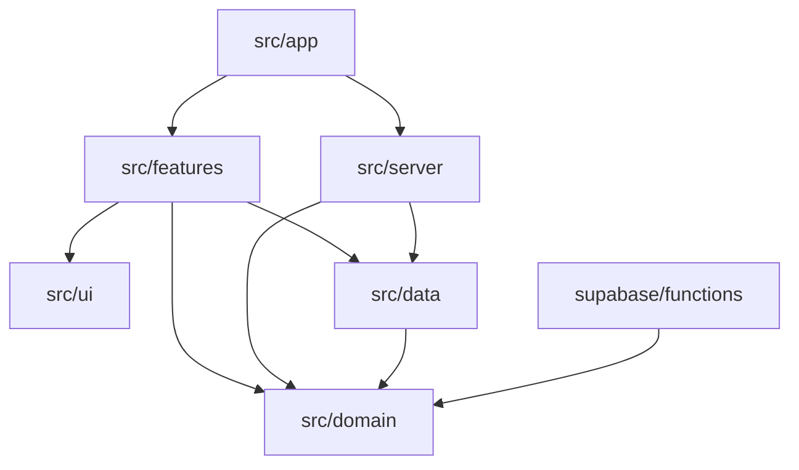
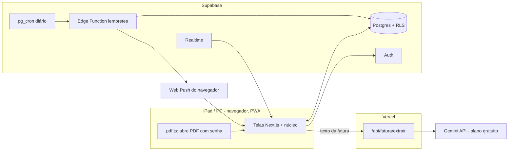
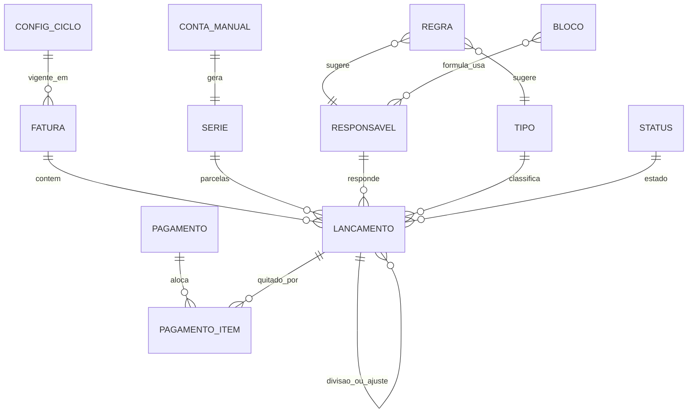

# Architecture Spine — Conta Comigo

## Design Paradigm

**Functional core, imperative shell.** Todo cálculo e toda regra de negócio vivem num núcleo de TypeScript puro (`src/domain`), sem acesso a rede, banco, relógio ou DOM. A casca (Next.js no navegador e no servidor, Supabase) busca dados, chama o núcleo e grava o resultado.

| Camada | Pasta | Pode depender de |
| --- | --- | --- |
| Núcleo de domínio | `src/domain` | nada além de TypeScript e `zod` |
| Acesso a dados | `src/data` | `src/domain`, `@supabase/*` |
| Funcionalidades (telas e estado de tela) | `src/features/<area>` | `src/domain`, `src/data`, `src/ui` |
| Componentes visuais | `src/ui` | nada de domínio nem de dados |
| Rotas do Next.js | `src/app` | `src/features`, `src/server` |
| Código só de servidor | `src/server` | `src/domain`, `src/data` |
| Funções agendadas | `supabase/functions` | `src/domain` (importado como código puro) |



## Invariants & Rules

### AD-1 — Regras de negócio só no núcleo de domínio

- **Binds:** FR-6, FR-8 a FR-12, FR-15, FR-19 a FR-33, FR-44 a FR-49, FR-53, FR-54, FR-55
- **Prevents:** duas telas (ex.: Painel e Recebimentos, Bloco e Mensagem) calcularem o mesmo valor de formas diferentes.
- **Rule:** Conferência, classificação (Regras, herança de parcelas, sugestões), Divisão, geração e casamento de previstos, Ajuste, avaliação de Fórmula, Mensagem de cobrança, alocação de Pagamento, estado derivado (Pago parcialmente, Atrasado), Ciclo/Mês, Previsão e lembretes são funções puras exportadas por `src/domain`. Telas, rotas, SQL e funções agendadas não reimplementam nenhuma dessas regras: chamam o núcleo. O núcleo não importa nada de `src/data`, `src/ui`, `src/app`, Next.js, Supabase nem APIs só de Node ou só de navegador, para rodar igual no navegador, na Vercel e no Deno das Edge Functions.

### AD-2 — Dinheiro em centavos inteiros

- **Binds:** todo valor em R$ (Lançamento, Divisão, Bloco, Pagamento, Previsão)
- **Prevents:** arredondamento acumulado e diferenças de 1 centavo entre telas.
- **Rule:** valores são inteiros em centavos (`integer` no Postgres, `number` inteiro no TS, nome terminado em `_centavos` / `Centavos`). Não existe `float` nem `numeric` para dinheiro. Na Divisão, o resto vai para a última parte. A Fórmula do Bloco calcula em racional exato (numerador/denominador inteiros) e arredonda para centavos só no resultado final, meio para cima. A exibição usa um único formatador do núcleo (`R$ 1.140,74`, `- R$ 0,08`).

### AD-3 — Supabase é a única fonte da verdade; sem internet, só leitura [ADOPTED]

- **Binds:** FR-34, FR-46, todas as gravações
- **Prevents:** filas locais divergentes, gravações duplicadas e conflitos de sincronização.
- **Rule:** toda gravação vai direto ao Supabase, e o app considera a gravação feita só quando o banco confirma. Sem conexão, o app mostra só os dados já carregados e bloqueia toda ação que grava, com o aviso do UX. Não existe fila de gravação no aparelho. Entre aparelhos, vale a última gravação (`updated_at`, definido pelo banco).

### AD-4 — Atualização em tempo real pelo banco

- **Binds:** FR-46, NFR "Atualização em tempo real"
- **Prevents:** telas desatualizadas e cada tela inventando seu próprio cache.
- **Rule:** cada aparelho assina o Supabase Realtime das tabelas do usuário. O estado de tela é derivado das linhas recebidas do banco e recalculado pelo núcleo. Uma tela pode mostrar uma gravação otimista, mas a desfaz se o banco recusar. Totais, Blocos e Saldos nunca são gravados no banco: são sempre recalculados a partir dos Lançamentos e Pagamentos.

### AD-5 — Usuário único com isolamento por dono [ADOPTED]

- **Binds:** FR-34, NFR Privacidade
- **Prevents:** dado acessível sem login e tabelas esquecidas sem proteção.
- **Rule:** login pelo Supabase Auth (e-mail e senha), com cadastro público desligado. Toda tabela de negócio tem `owner_id uuid not null default auth.uid()` e RLS ligado, com políticas `owner_id = auth.uid()` para ler e gravar. A chave de serviço do Supabase só existe no servidor e nas Edge Functions.

### AD-6 — Identidade do Lançamento: Nome manda, Apelido só aparece

- **Binds:** FR-5, FR-8, FR-9, FR-10, FR-45, FR-47, FR-52
- **Prevents:** Regras e previstos casarem pelo texto errado, ou um Apelido quebrar o reconhecimento.
- **Rule:** `nome` guarda o texto exato da Fatura e nunca é alterado. `nome_normalizado` é calculado só pela função de normalização do núcleo e é a única chave de Regras, previstos e Ajustes. `apelido` é só exibição e nunca participa de comparação. `lancado_por` é um enum fechado: `fatura`, `sistema`, `manual`, `historico`.

### AD-7 — Importação da Fatura: senha no aparelho, extração no Gemini, gravação atômica

- **Binds:** FR-3, FR-4, FR-5, FR-6, FR-7, FR-47, FR-51
- **Prevents:** a senha sair do aparelho, o PDF ser guardado, e uma importação pela metade.
- **Rule:**
  1. O navegador abre o PDF com a senha usando `pdfjs-dist` e extrai o texto, página a página. A senha e o arquivo nunca saem do aparelho.
  2. O texto vai para a rota autenticada `POST /api/fatura/extrair`, que chama o Gemini (plano gratuito) com saída estruturada. Essa rota não grava nada e não registra o texto em log.
  3. A resposta é validada por um schema `zod` do núcleo. O núcleo faz a Conferência (totais da Fatura e de cada cartão), reconhece Ajustes, casa os previstos e classifica.
  4. A gravação é uma única chamada RPC em transação (`importar_fatura`), que insere a Fatura e os Lançamentos, troca os previstos casados e, na reimportação (FR-51), apaga antes os Lançamentos `fatura` do Mês e os previstos criados por ela. Ou grava tudo, ou nada.

### AD-8 — Parcelas pertencem a uma Série

- **Binds:** FR-8, FR-17, FR-44, FR-45, FR-46, FR-47
- **Prevents:** duas linhas para a mesma parcela e previstos órfãos.
- **Rule:** toda compra parcelada e toda Conta manual tem uma `serie`. Cada parcela é um Lançamento com `serie_id` e `parcela_n`/`parcela_total`. Existe uma restrição única `(serie_id, parcela_n)` entre os Lançamentos não excluídos e não divididos: o previsto e o real da mesma parcela são a **mesma linha**, que muda de `sistema` para `fatura` ao casar. Lançamentos de uma Divisão apontam para o Lançamento original (`dividido_de_id`), que fica oculto. Um Ajuste aponta para a parcela (`ajuste_de_id`).

### AD-9 — Mês é o mês de vencimento; o Ciclo só decide os lançamentos manuais

- **Binds:** FR-17, FR-22, FR-36, FR-41
- **Prevents:** um lançamento cair em meses diferentes dependendo da tela, e o fuso horário mudar o mês.
- **Rule:** todo Lançamento tem `mes` no formato `AAAA-MM` (mês de vencimento da Fatura). Na importação, `mes` vem do vencimento lido. Para lançamentos criados no app, a função de Ciclo do núcleo calcula `mes` a partir da data e da configuração de fechamento vigente naquela data (configuração com data de início, sem reescrever o passado). Datas de calendário são `date`, momentos são `timestamptz`, e "hoje" é sempre calculado em `America/Sao_Paulo`.

### AD-10 — Status guardado, estados derivados calculados; Pagamento é alocação

- **Binds:** FR-25, FR-26, FR-27, FR-28, FR-29, FR-49, FR-50
- **Prevents:** "Atrasado" ou "Pago parcialmente" desatualizados no banco, e Saldos que não fecham com os Pagamentos.
- **Rule:**
  - O Lançamento guarda só `status_id`, um Status do usuário com `conta_como_pago`.
  - "Pago parcialmente" e "Atrasado" são calculados pelo núcleo e nunca gravados.
  - Um Pagamento tem `valor_recebido_centavos`, `data`, `modo` (`total`, `parcial` ou `minha_parte`) e `pagamento_itens`, com o valor quitado de cada Lançamento. O núcleo gera os itens (ordem: do mais antigo para o mais novo).
  - Desfazer um Pagamento apaga o Pagamento e os itens e devolve o Status anterior guardado no item.
  - A Dívida programada é `vencimento_combinado` no próprio Lançamento.

### AD-11 — Fórmula do Bloco guardada como árvore, nunca como texto

- **Binds:** FR-19, FR-20, FR-26, FR-31, FR-53, FR-54
- **Prevents:** formatos de fórmula divergentes e avaliação feita fora do núcleo.
- **Rule:** a Fórmula é guardada em `jsonb` como uma árvore validada por um schema `zod` do núcleo. Os nós são operando (Responsável, Tipo, Responsável em Tipo, Todos), número, operação (+ − × ÷) e grupo. Só o avaliador do núcleo calcula o valor, o passo a passo e a lista de Lançamentos que entram, e só o gerador de mensagem do núcleo produz o texto (FR-24, FR-28, FR-53). Bloco de cobrança e "meu Bloco" são flags do Bloco.

### AD-12 — Segredos só no servidor

- **Binds:** FR-3, FR-55, NFR Privacidade
- **Prevents:** chave do Gemini, chave de serviço do Supabase ou chave VAPID no código do navegador.
- **Rule:** `GEMINI_API_KEY`, `SUPABASE_SERVICE_ROLE_KEY` e `VAPID_PRIVATE_KEY` existem só nas variáveis de ambiente da Vercel e dos segredos das Edge Functions. Nunca usam o prefixo `NEXT_PUBLIC_`. Toda rota em `src/app/api` exige sessão válida do Supabase.

### AD-13 — Lembretes: agendamento no Supabase, regra no núcleo

- **Binds:** FR-49, FR-55
- **Prevents:** a regra de "atrasado" do lembrete divergir da regra da tela.
- **Rule:** um `pg_cron` diário (09:00 em `America/Sao_Paulo`) chama a Edge Function `lembretes`. Ela lê os dados, usa as funções de lembrete e atraso do núcleo e envia Web Push (VAPID) para as inscrições guardadas em `push_inscricoes`. A faixa do app usa as mesmas funções. Um lembrete enviado é registrado em `lembretes_enviados (tipo, referencia, dia)` para não repetir.

### AD-14 — Schema só por migração

- **Binds:** todas as tabelas
- **Prevents:** o banco e o código discordarem sobre o schema.
- **Rule:** toda mudança de schema é um arquivo em `supabase/migrations`, aplicado pela CLI do Supabase. Os tipos TypeScript do banco são gerados (`supabase gen types`) para `src/data/database.types.ts`. Não se altera o schema pelo painel.

## Consistency Conventions

| Concern | Convention |
| --- | --- |
| Termos do domínio | Os nomes no código seguem o Glossário do PRD, em português sem acento: `lancamento`, `responsavel`, `tipo`, `bloco`, `formula`, `pagamento`, `serie`, `fatura`, `conta_manual`, `regra`, `status`. Nunca `transaction`, `category`, `customer`. |
| Nomes | Tabelas e colunas em `snake_case` no plural (`lancamentos`). TS em `camelCase` e tipos em `PascalCase`. Arquivos em `kebab-case.ts`. Componentes React em `PascalCase.tsx`. |
| IDs | `uuid` gerado pelo banco (`gen_random_uuid()`). |
| Dinheiro | `*_centavos integer` (AD-2). |
| Datas | `date` para dias, `timestamptz` para momentos, `mes text` no formato `AAAA-MM`. A exibição usa os formatadores do núcleo: `DD/MM/AA`, `HH:MM`, `Out/26`, `outubro/26`. |
| Erros | O núcleo devolve `{ ok: true, valor }` ou `{ ok: false, erro: { codigo, detalhe } }` e não lança exceção para regra de negócio. Os textos para o usuário vêm de um mapa único `codigo → mensagem`, no tom do EXPERIENCE.md. |
| Validação | Toda entrada externa (resposta do Gemini, linha da planilha, corpo de rota) passa por um schema `zod` do núcleo antes de ser usada. |
| Gravação | Toda gravação passa pelos repositórios de `src/data`. As telas não chamam `supabase.from()` diretamente. Operações com mais de uma tabela (importar, pagar, dividir, reimportar) são funções RPC em SQL com transação. |
| Estilo visual | Os tokens do DESIGN.md viram variáveis CSS e o tema do Tailwind. Os componentes shadcn/ui são ajustados a esses tokens, e não se usa cor literal em componente. |
| Testes | Toda função do núcleo tem teste em Vitest. Os números de outubro/2026 (Casal R$ 5.639,35, Casal ÷ 2 = R$ 2.819,68, Mãe R$ 1.350,14, Lucas R$ 215,16, Total R$ 9.280,23, 49 Lançamentos e Conferência de R$ 8.327,39 / R$ 639,62) são testes de aceite obrigatórios. |

## Stack

| Name | Version |
| --- | --- |
| TypeScript | 5.9 |
| Next.js (App Router) | 16.2.x |
| React | 19.x |
| Tailwind CSS | 4.x (a versão atual no `create`) |
| shadcn/ui | CLI atual no momento do init |
| @supabase/supabase-js | 2.105+ |
| @supabase/ssr | atual no momento do init |
| Supabase (Postgres, Auth, Realtime, Edge Functions, pg_cron, pg_net) | serviço gerenciado |
| pdfjs-dist | 5.6.x |
| @google/genai | 1.51+ (modelo Flash gratuito vigente) |
| zod | atual no momento do init |
| Vitest | atual no momento do init |
| Vercel | hospedagem do Next.js |

## Structural Seed





**Ambientes:**
- **Produção:** branch `main` → Vercel Production + projeto Supabase de produção.
- **Testes:** Pull requests → Vercel Preview, usando o Supabase local (`supabase start`) ou um projeto de desenvolvimento. O Preview nunca aponta para o banco de produção.
- **Desenvolvimento local:** `next dev` + `supabase start`.

```text
conta-comigo/
  src/
    domain/      # núcleo puro: dinheiro, ciclo, normalização, conferência, classificação,
                 # divisão, previstos, ajuste, fórmula, mensagem, pagamento, lembretes + testes
    data/        # cliente Supabase, repositórios, realtime, database.types.ts
    features/    # painel, revisar, recebimentos, previsao, contas-manuais, configuracoes, importar
    ui/          # tokens do DESIGN.md, componentes shadcn ajustados
    server/      # cliente Gemini, prompt e schema de extração
    app/         # rotas do Next.js (páginas e /api/fatura/extrair), manifest da PWA
  supabase/
    migrations/  # schema, RLS, RPCs (importar_fatura, aplicar_pagamento, dividir, ...), pg_cron
    functions/
      lembretes/ # Edge Function que importa src/domain
```

## Capability → Architecture Map

| Capability / Area | Lives in | Governed by |
| --- | --- | --- |
| Configuração inicial, importar planilha (FR-1, FR-2) | `features/configuracoes`, `domain/importacao-planilha` | AD-1, AD-6, AD-8 |
| Importação da Fatura (FR-3 a FR-7, FR-47, FR-51) | `features/importar`, `server/gemini`, RPC `importar_fatura` | AD-7, AD-6, AD-8 |
| Ciclo e Mês (FR-36) | `domain/ciclo` | AD-9 |
| Classificação e Regras (FR-8 a FR-12) | `domain/classificacao`, `features/revisar` | AD-1, AD-6 |
| Previstos (FR-44, FR-45) | `domain/previstos` | AD-8 |
| Revisão e Divisão (FR-13 a FR-15) | `features/revisar`, `features/painel`, RPC `dividir_lancamento` | AD-1, AD-2, AD-8 |
| Contas manuais (FR-16 a FR-18) | `features/contas-manuais`, `domain/previstos` | AD-8, AD-9 |
| Painel, Blocos, Fórmula, filtros (FR-19 a FR-22, FR-54) | `features/painel`, `domain/formula` | AD-11, AD-2, AD-4 |
| Seleção e Mensagem (FR-23, FR-24, FR-48, FR-53) | `features/painel`, `domain/mensagem` | AD-11, AD-1 |
| Recebimentos e Pagamentos (FR-25 a FR-30, FR-49) | `features/recebimentos`, `domain/pagamento`, RPC `aplicar_pagamento` | AD-10 |
| Previsão e gasto por Tipo (FR-31 a FR-33) | `features/previsao`, `domain/previsao` | AD-1, AD-11 |
| Login, sincronização e edição em tempo real (FR-34, FR-46) | `data/`, Supabase Auth e Realtime | AD-3, AD-4, AD-5 |
| Instalar como app (FR-35) | `app/manifest`, service worker | AD-3 |
| Status (FR-50) | `features/configuracoes` | AD-10 |
| Apelido (FR-52) | `features/painel` | AD-6 |
| Lembretes (FR-55) | `supabase/functions/lembretes`, `domain/lembretes` | AD-13 |

## Deferred

- **Leitor próprio do PDF (plano B do Gemini):** só se o plano gratuito falhar ou limitar.
- **Biblioteca de estado de tela:** a funcionalidade escolhe, desde que derive do banco (AD-4).
- **Cache de leitura sem internet:** o mecanismo (service worker ou cache em memória/IndexedDB) fica com a story da PWA, respeitando AD-3 (sem gravação).
- **Versão para iPhone:** fase 2.
- **Schema da fase 2 (Salário, Despesa extra, Orçamento) e da fase 3 (Objetivos, Fatura do Rangel):** sem tabelas na v1.
- **Busca em todos os meses:** melhoria futura.
- **Pipeline de CI (lint, testes, migração) e monitoramento de erros:** definidos na primeira story de infraestrutura.
- **Modelo exato do Gemini:** o Flash gratuito vigente na implementação, trocável por configuração.
